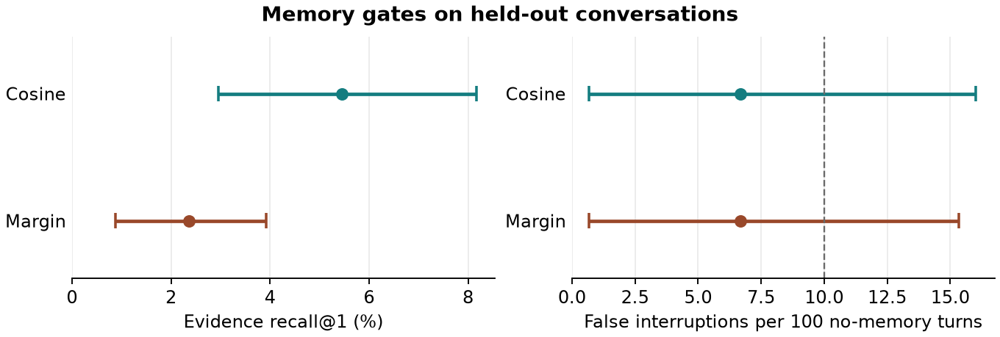

# When should memory stay quiet?

A local benchmark for deciding whether to surface one retrieved memory. This is an independent demo and does not use or evaluate Engramme's system.

## Held-out results

| Gate | Threshold | Evidence recall@1 (95% CI) | False interruptions per 100 no-memory turns (95% CI) |
| --- | ---: | ---: | ---: |
| Top cosine | 0.550 | 5.44% [2.96, 8.17] (30/551) | 6.67 [0.67, 16.00] (10/150) |
| Top-1 minus top-2 cosine | 0.097 | 2.36% [0.87, 3.93] (13/551) | 6.67 [0.67, 15.33] (10/150) |

Margin lost 3.09 percentage points of recall (paired 95% CI for margin minus cosine: [-4.60, -1.82]). Both gates interrupted 10 times, with no observed reduction for margin (paired difference per 100: 0.00 [-10.00, 11.33]). Ungated retrieval found the exact evidence turn for 58/551 queries (10.53%).



The dashed line marks the calibration budget.

## Run

Use Python 3.13. The initial fetch needs internet access and saves pinned files to `.cache/`. Inference runs locally on CPU and needs no API key.

```sh
python -m pip install -r requirements.txt
python fetch.py
python -m unittest -v
python evaluate.py
python evaluate.py --ask "Hey, nice to see you!" --conversation conv-50 --gate cosine
```

## Method and limits

- Sort the 10 LoCoMo conversations by ID and alternate between calibration and test (five each). Calibration had 571 positive queries and test had 551. Positives were benchmark questions in categories 1-4 with exactly one resolvable annotated evidence turn. Each conversation's full text transcript served as its memory index. A hit required surfacing the exact labeled turn. Abstentions and wrong IDs both counted as misses.
- Each split used 30 distinct, independently written no-memory prompts, each paired with all five conversation indexes (150 evaluations per split). Greetings and small talk need only a social response. Standalone questions and requests include the information needed in the turn itself. Those rules define the negative labels. Any surfaced turn counted as a false interruption.
- Both gates rank the same normalized MiniLM embeddings by cosine similarity and surface the winner only when the gate score strictly exceeds its threshold. Search the 0.001-spaced grid from 0 to 1 on calibration, maximizing correct surfaces with a budget of 10 false interruptions per 100. Break ties by fewer interruptions, then higher threshold. Freeze both thresholds for test.
- The 95% percentile intervals use 10,000 paired bootstrap draws, resampling held-out conversations and negative prompts independently with replacement. Thresholds stay fixed. Five test conversations and synthetic negatives limit generalization. Offline transcripts, single-evidence questions and exact turn IDs leave out live memory timing, answers requiring multiple turns and alternative valid evidence.

[LoCoMo paper (Maharana et al., 2024)](https://aclanthology.org/2024.acl-long.747/) and [upstream CC BY-NC 4.0 license](https://github.com/snap-research/locomo/blob/3eb6f2c585f5e1699204e3c3bdf7adc5c28cb376/LICENSE.txt). The repository distributes aggregate results and fetches the dataset from upstream. Embeddings use [all-MiniLM-L6-v2](https://huggingface.co/sentence-transformers/all-MiniLM-L6-v2).
